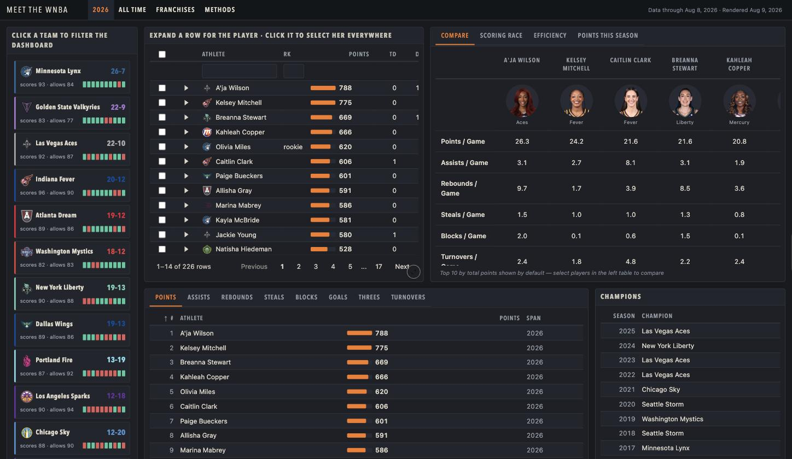

# Meet the WNBA

A cross-filtering dashboard of WNBA player and franchise history, built with
[Quarto](https://quarto.org), [reactable](https://glin.github.io/reactable/),
[plotly](https://plotly-r.com) and
[crosstalk](https://rstudio.github.io/crosstalk/), from data supplied by the
[wehoop](https://wehoop.sportsdataverse.org/) R package.

**[View the dashboard →](https://connect.posit.cloud/jeremyallen/content/019fce5e-f2d4-6c4b-7bde-bcc8564b62e3)**



The dashboard is one self-contained HTML file. The current local render is
about 8.6 MB. No server or Shiny process runs behind it. Everything below
happens in the reader's browser after one download:

- Click a player in any table, and every other table and chart updates:
  leaderboards narrow to her, charts reduce the opacity of the other players,
  her team's standings card gains a highlight, and the comparison table replaces
  its ten default columns with the players selected.
- Click a team card and every table and chart filters to that roster.
- Expand any row for a portrait, splits, and a game-by-game bar chart.
- Sort, filter, and page through the tables, and hover charts for tooltips.
- On the **2026 Playoffs** page, check the bracket and the **Watch** listing for
  each scheduled game, including games whose teams remain undecided.

The standard packages produce almost all of that behavior. The
[second half of this README](#interactivity-without-a-server) measures how much
they do on their own, marks where they stop, and explains the small amount of
custom JavaScript.

---

## The dashboard

Five pages:

| Page | What's on it |
|---|---|
| **2026** | Standings cards, a player table with expandable panels, a comparison table, scoring-race / efficiency / points charts, eight stat leaderboards, and the champions list |
| **2026 Playoffs** | A seeded bracket, a game schedule with a **Watch** listing for each slot, playoff player totals and game logs, comparison views, charts, and eight playoff leaderboards. Before the first playoff game, the player views explain that no playoff games have been completed. |
| **All Time** | Career leaders with expandable career panels; a tabset of time on the court, The Chase (every career worth 1,500+ points), career efficiency, three-point and attendance trends; and eight career leaderboards |
| **Franchises** | Franchise lineage: every rename and relocation the league has had, drawn as a timeline |
| **Methods** | The rules below, stated on the page itself |

### Where the data comes from

`wehoop::load_wnba_player_box()` and `load_wnba_schedule()` read pre-built files
from the **sportsdataverse-data** GitHub releases. That repository mirrors ESPN
and rebuilds on its own schedule, usually a day or two behind. It re-uploads the
release asset whether or not new games were ingested, so a fresh file timestamp
is not evidence of fresh data.

`update_data.R` closes that gap. After the bulk pull it requests any completed
game the mirror is missing from ESPN directly and merges it in, then asserts
full season coverage and non-NA keys before writing `dat.rds` and `sched.rds`. A
broken fetch stops the script rather than caching an incomplete file.

The navbar shows two dates. **Data through** gives the date of the most recent
game in the data, and **Rendered** gives the date the page was last built.
Because rendering fetches nothing, the two dates diverge whenever the page is
rebuilt without a data refresh.

> The `arrow` package must stay installed. Season files before 2024 store their
> columns as arrow ALTREP vectors, and without it `readRDS` silently returns
> zero-length vectors that get padded to NA. The result carries the right row
> count and the right date range and contains no data.

### How games and stats are computed

The **2026** and **All Time** pages count regular-season games only
(`game_kind == "regular"`). The **2026 Playoffs** page counts playoff games only
(`game_kind == "post"`). All-Star exhibitions and the Commissioner's Cup are
excluded from both kinds of player totals. Career totals exclude playoff games.
The data load sorts each game once, because neither column in the schedule
carries the answer alone. `type_id` names a *round*, and the playoff rounds only
exist from 2019 on, so every playoff game from 2004 through 2018 looks like a
regular-season one by `type_id`, which makes `season_type` the column that
separates the two in every year. The load drops All-Star rosters by game type
rather than by team id, because ESPN issues six-digit ids to new franchises as
well as to exhibition rosters, so a threshold on the id would delete Golden
State, Toronto and Portland along with the exhibitions.

**One career, one name.** Every box-score row an `athlete_id` owns takes the
most recent name that id used, so a player who has changed hers holds one career
rather than two, Skylar Diggins carrying all 5,758 of her points instead of
4,255 under one name and 1,541 under another. Four players whom ESPN gave a new
id as well as a new name are merged by a short list in `checks.R`.

**The box scores start in 2004**, and the league started in 1997, so a career
that opened earlier is counted only from 2004 on.

**A box-score row is not a game played.** ESPN carries one row per rostered
player per game, whether or not she took the floor. A row counts only when
`did_not_play` is not `TRUE` *and* the row carries a stat line (`points` is not
`NA`). The second condition exists because `did_not_play` only became reliable
in 2013. Before then, inactive players ESPN never flagged make up 10–22% of the
rows in each season.

Counting roster appearances instead of games played puts each game a player
missed into her denominator, which pulls every per-game average below ESPN's.

**Totals** are the sum of `points` across counted games, and **per game**
divides by games played on that same definition, so games missed never enter the
denominator.

**Who qualifies for a ranking.** The 2026 regular-season comparison table applies the league's own
scoring minimum, 70% of the games her team has played, or 525 points. Those
[minimums](https://stats.wnba.com/help/statminimums/) are written per season and
gate season leaders. Career totals take none, because the league applies none to
its all-time lists. The playoff comparison table applies no regular-season
minimum and shows playoff games played beside each per-game rate.

The playoff page reads game dates and broadcast outlets from the schedule cache.
It adds confirmed simulcasts from the [WNBA's 2026 postseason
FAQ](https://www.wnba.com/news/2026-wnba-postseason-faq). A scheduled slot can
name an outlet before its teams are known. The page labels conditional games
and stops showing an unplayed conditional slot once its decided series can be
identified, or once every series in that round is decided.

📄 **[METHODOLOGY.md](METHODOLOGY.md)** states the full rules, what the 2004
floor costs each pre-2004 career, and how the rest measures against the league's
own all-time figures, with all 758 careers the league lists sorted by the cause
of their gap.

---

## Interactivity without a server

Every interaction on this page runs in the browser. There is no Shiny app.
Posit Connect Cloud serves the published version as a static asset.

### The whole mechanism, in one line

```r
SharedData$new(df, key = ~athlete, group = "experience")
```

`crosstalk::SharedData` wraps a data frame and declares two things: a **key**
column and a **group** name. Every widget built from a `SharedData` carrying the
same group name joins one broadcast channel keyed on athlete name. Selecting a
row in one widget publishes a set of keys, and every other widget in the group
receives those keys and updates itself: reactable hides the rows whose keys are
absent, and plotly reduces the opacity of the unselected traces.

No other code connects the widgets. There is no event bus, no observer, no
callback registry, and no code anywhere in this repository that reads a click in
one widget and updates another.

The player tables and interactive charts join that group across the 2026,
2026 Playoffs, and All Time pages. The comparison tables need custom JavaScript
because players are columns there, as described below.

### What the standard packages do on their own

| Behavior | What provides it | Written here |
|---|---|---|
| Row selection broadcasts to the whole page | `reactable(selection = "multiple", onClick = "select")` on a `SharedData` | 2 arguments |
| Every other table narrows to the selection | crosstalk and reactable, built in | nothing |
| Charts highlight the selection and reduce the opacity of the rest | `ggplotly() \|> highlight(color =, opacityDim =, selected = attrs_selected())` | 1 pipe per chart |
| Selection **and** filter applied together | reactable intersects the two crosstalk channels per table | nothing |
| Sort, per-column filter, pagination, striping, row highlight | `reactable()` arguments | 1 argument each |
| Expandable row showing a portrait, splits, and game-by-game bars | `details = colDef(html = TRUE, details = function(i) ...)` | an htmltools builder |
| Bar-in-cell leaderboards | `colDef(cell = ...)` returning markup | a 15-line helper |
| Chart tooltips | `hovertemplate` | a 10-line helper |
| Tabsets, cards, scrolling, layout, navbar | Quarto `format: dashboard` | markdown headings |

The fourth row is the most valuable. Readers usually assume it needs
Shiny. Selection and filtering work on **separate crosstalk channels**, and
reactable intersects the two per widget, so a team filter narrows every table on
the page while a row selection still highlights rows *within* that narrowed set.
No coordination code produces this.

Three charts are deliberately static: the franchise lineage, the three-point
trend, and the attendance trend all render as device-drawn SVG. No athlete
belongs to any of them, so a selection has nothing to change in them. Passing
them through `ggplotly()` would also cost accuracy, because it drops
`plot.subtitle` silently and ignores a mapped `hjust`, which centred every
franchise label and ran the long ones off the panel.

### Where the standard packages stop


Four behaviors on this page fall outside what crosstalk can express, and they
account for all of the JavaScript. Each one reaches a real limit of the
crosstalk model.

**1. The team cards are a filter source, but not a widget.** (`standings_js`,
111 lines.) The standings column consists of hand-built `htmltools` divs, and
crosstalk connects only to htmlwidgets, so the cards cannot be a crosstalk
endpoint. The script constructs a `crosstalk.FilterHandle` directly and sets it
from an R-generated team-to-roster map, so clicking a card filters the group to
that roster. The only standard alternative, `crosstalk::filter_select()`,
renders a dropdown and would have replaced the standings display entirely. The
remaining lines produce the visual response: the highlight on a selected card,
the bounce when a second player from an already-highlighted team is added, and
the scroll that brings a highlighted card into view.

**2. The comparison table is pivoted, so players are columns.** (`compare_js`,
77 lines.) Crosstalk filters *rows* and cannot express a selection that changes
which **columns** are visible. The script listens on a `SelectionHandle` and
calls `Reactable.setHiddenColumns()`, choosing the narrowest set available: the
players selected, or failing that the roster being filtered to, or failing that
the top ten the table opens on.

**3. Clearing a filter that belongs to another script.** A crosstalk handle
clears only its own contribution to the group, and the team filter belongs to
the standings script. The Clear button therefore sits outside the tables,
because a selection can leave the visible table with no row to untick, and it
requests the removal through a custom DOM event, `wnba:clear-filter`.

**4. A table keyed on the wrong column.** (4 lines.) The champions table is
keyed by season rather than by athlete, so it cannot join the group. The
standings script passes the team name to it through `Reactable.setMeta()`, and a
`rowClass = JS(...)` callback reads that metadata on every render, so the
highlight survives a sort. A class written onto the rows once would not.

These scripts compute no statistics. They read no data, build no table markup,
and define no event system of their own. Every line either
instantiates a documented crosstalk handle, calls a documented `Reactable.*`
method, or toggles a CSS class. The visual states themselves live in
`styles.scss`: `.is-selected`, `.is-filtering`, `.is-bounce` with its
`@keyframes` and a `prefers-reduced-motion` guard, and `.champ-lit`.

Two costs:

- **The scripts depend on rendered element ids**: `main-table`,
  `all-time-table`, `compare-table`, `champions`, and `#standings`. Renaming an
  `elementId` will break the JavaScript silently.
- **One line is a workaround.** Deselecting the last row broadcasts `[]`, which
  plotly ignores. `TraceManager.prototype.updateSelection` restores
  `origOpacity` only when `keys === null`, and adds the highlight traces only
  when `keys.length >= 1`, so an empty array matches neither condition. Every
  chart then keeps the reduced opacity from the selection just cleared, with no
  trace highlighted. Broadcasting a strict `null` restores them.

### What this approach cannot do

Everything the page can show must be **in** the page. Nothing is queried on
demand: the 933 career panels and 226 season panels behind the expandable rows
are all pre-rendered, whether or not a reader opens one. The file is
self-contained and can be copied or emailed, and it computes nothing new after
the render. A model fit at request time, a database, user accounts, or any write
still requires Shiny.

### Keeping the file size down

Because the page carries all of its data and markup, its size needs watching.
Before the playoff page was added, five changes took a render from **14.7 MB to
7.6 MB (−48%; 2.65 MB → 1.43 MB gzipped)** on identical data:

| Saved | Measure | Where |
|---:|---|---|
| 2.58 MB | plotly's **basic** bundle instead of the full one | `partial_bundle(type = "basic")` |
| 2.48 MB | reactable given **markup**, not htmltools tags | `colDef(html = TRUE)` |
| 1.38 MB | duplicate Bootstrap deleted after render | `slim_dashboard.R` |
| 0.39 MB | one `hovertemplate` per trace instead of per-point tooltip text | `hovertemplate` + `customdata` |
| 0.35 MB | svglite figures instead of 2× PNG | `fig-format: svg`, `dev: svglite` |

Three of those generalise to any Quarto page using these widgets:

- **reactable serialises htmltools tags as a React tag tree**, writing every
  element out as `{"name":...,"attribs":...,"children":[...]}`, roughly twice
  the length of the markup it stands for. Passing it a markup *string* with
  `html = TRUE` on the column stores the markup instead. That took 5.81 MB to
  3.20 MB here, and nothing about it is visible from the R side.
- **`partial_bundle()` must be applied to every chart.** It renames the html
  dependency from `plotly-main` to `plotly-basic`, so if one chart stays on the
  full bundle, the page embeds both and ends up larger than before. Name the
  bundle rather than using `type = "auto"`, which silently falls back to the
  full one.
- **Quarto 1.10 embeds every stylesheet three times, and no setting prevents
  it.** A dashboard whose entire body is the word "Hello." renders at 2.72 MB.
  `slim_dashboard.R` removes the duplicates after the render by grouping the
  `<link>`s by `href` and keeping the first of each. It reports how many it
  dropped, and once Quarto fixes the defect it will report that it found none,
  at which point the script can go.

📄 **[FILESIZE.md](FILESIZE.md)** records every measurement and the gotchas
behind each one in that earlier render. The current render is larger because it
includes the playoff page.

---

## Building it

[`just`](https://github.com/casey/just) drives the three steps:

```sh
just data      # refresh dat.rds / sched.rds from wehoop, topped up from ESPN
just render    # quarto render + slim_dashboard.R
just publish   # upload dashboard.html to Posit Connect Cloud, --no-render
just update    # all three, in order
```

The render step matters to `update`. `quarto publish` runs with `--no-render`
and uploads `dashboard.html` exactly as it sits on disk, so going straight from
new data to publishing would upload the previous build and report success.

[renv](https://rstudio.github.io/renv/) pins the R packages. Restore them with
`renv::restore()`. The `library(svglite)` call in the setup chunk exists for the
*snapshot* rather than for the render, because implicit snapshots read
`library()` calls and not the YAML that names the device.

## Repository layout

| | |
|---|---|
| `dashboard.qmd` | the whole dashboard: data prep, helpers, widgets, JavaScript |
| `styles.scss` | theme tokens and the CSS behind every interactive state |
| `update_data.R` | wehoop pull, ESPN top-up, assertions, cache write |
| `checks.R` | champion rule, career names, and the checks that stop a bad update |
| `tests/test-checks.R` | offline tests of `checks.R`, run with `just test` |
| `reconcile_careers.R` | sorts each career's gap from the league's totals by cause |
| `slim_dashboard.R` | post-render removal of Quarto's duplicate stylesheets |
| `justfile` | data, then render, then publish |
| `METHODOLOGY.md` | what counts as a game, and the differences from ESPN |
| `FILESIZE.md` | how the rendered page was halved |
